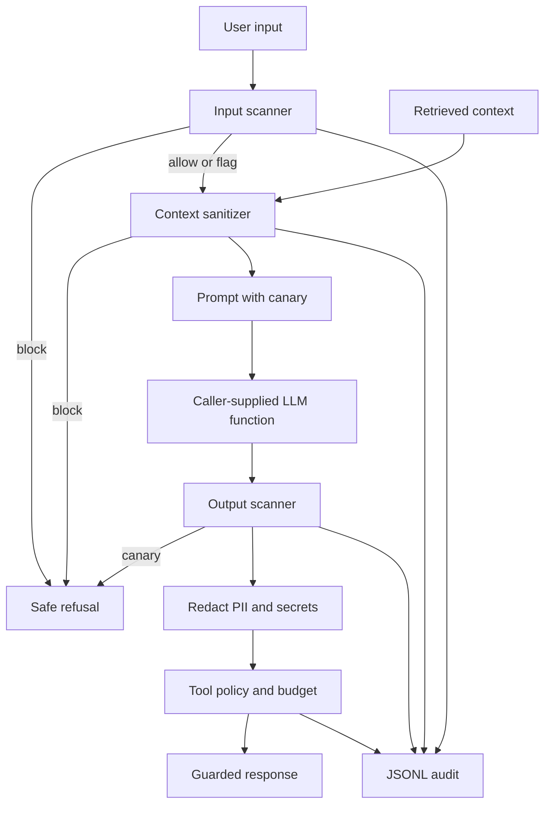

# llm-guardrail-lite

A small Python library that wraps any LLM call with explainable checks. The model is a function you pass in: it takes a prompt string and returns text. The guardrail scans the user text, sanitizes retrieved context, calls that function only when the input checks allow it, redacts the output, and validates any tool call the model proposes.

It is rule-based on purpose. A match has a rule id, a weight, and a sentence that says why. There is no machine-learning model and no network call inside the library.

## What it protects against

- Instruction-override phrasing, role-play jailbreak phrasing, and requests to reveal a system prompt.
- Fake system-message delimiters in user text or in retrieved text.
- "Decode and follow" phrasing, exfiltration phrasing, and tool-abuse phrasing.
- Indirect injection in retrieved context: hidden characters are stripped, delimiters are neutralized, the text is scanned, and a block verdict never reaches the model.
- Verbatim system-prompt leakage, using a canary token placed in the system section.
- Emails, phone numbers, Luhn-valid card numbers, and a handful of secret-shaped tokens in the output (redacted, then returned).
- Tool calls that are not on the allowlist, that fail their argument schema, or that use a URL with a disallowed scheme, credentials, localhost, or a private, loopback, or link-local IP literal.
- A single reply that proposes more tool calls than the per-run budget.

## What it does not do

- It does not understand meaning. A paraphrase that misses the rule table is allowed.
- It does not call a real LLM, and it does not ship an SDK.
- It does not resolve DNS, so a hostname that points at a private address is not detected.
- It does not cover every kind of personal data.
- It does not rate-limit across users, and it does not provide a monitoring dashboard.
- It does not execute tools. It returns decisions. The host must honor them.
- It is a learning project, not a certified or production security product.

## Architecture



## Install

Python 3.11 or newer. From the repository root:

```text
python -m pip install -r requirements.txt
```

The package lives in `src/guardrail`. Tests add that directory via `pytest.ini`. For the CLI, put `src` on `PYTHONPATH`.

## Library example

Illustrative only. This is not a captured run, and the reply string below is the fake function's return value, not a measured model output.

```python
from guardrail import GuardedLLM, GuardrailConfig

def my_llm(prompt: str) -> str:
    return "example reply"

guard = GuardedLLM(my_llm, GuardrailConfig())
result = guard.invoke("Summarize the notes", context="Notes from the meeting.")
```

`result.verdict` is `allow`, `flag`, or `block`. `result.llm_called` is false when the input or the context was blocked. `result.text` is either the redacted reply or a fixed refusal. `result.tool_decisions` lists calls parsed from lines that start with `TOOL_CALL:` and a one-line JSON object `{"name": "...", "arguments": {...}}`.

## CLI

Documented, not required for the tests. From the repository root, with `src` on `PYTHONPATH`:

```text
python -m guardrail.cli scan --text "Summarize the notes"
```

The command prints one JSON object and exits 0 for allow, 1 for flag, and 2 for block. Optional flags: `--flag-threshold` and `--block-threshold`. The flag value must be less than or equal to the block value.

## Configuration

| Setting | Default | Role |
| --- | --- | --- |
| `flag_threshold` | 3.0 | Score at or above this is flag, until it reaches the block line. |
| `block_threshold` | 6.0 | Score at or above this is block. |
| `max_input_chars` | 8000 | Longer user text is truncated and flagged. |
| `max_context_chars` | 16000 | Longer retrieved text is truncated and flagged. |
| `max_output_chars` | 8000 | Longer redacted output is truncated and flagged. |
| `base64_min_length` | 40 | Minimum length of a base64-shaped token before it is flagged. |
| `base64_weight` | 3.0 | Weight of that single finding. The blob itself is not stored. |
| `tool_allowlist` | search, calculator, get_time | `http_get` is implemented and off until you add it. |
| `tool_call_budget` | 8 | Proposed tool calls allowed in one `invoke`. |
| `url_scheme_allowlist` | https | Other schemes are rejected. |
| `url_host_allowlist` | empty | Empty allows any hostname that passes the IP and localhost checks. A non-empty list allows only those hosts. |
| `canary_token` | empty | Empty means each `GuardedLLM` generates its own token. |
| `redaction_token` | `[REDACTED]` | Replacement for PII, secrets, and the canary. |

Critical rules weigh 6. Softer rules weigh 4. Each rule counts at most once. See `DECISIONS.md`.

## Tests

Offline. The tests use `FakeLLM` and call the CLI functions directly.

```text
python -m pytest
```

`tests/test_corpus.py` prints a `MEASURED` line. A sample counts as a detection when the verdict is flag or block.

## Measured corpus results

Measured on the small local test corpus (the `MEASURED` line from `python -m pytest -s`, test `tests/test_corpus.py::test_corpus_metrics`):

```text
corpus_size=86 malicious=43 benign=43 tp=43 fp=0 tn=43 fn=0 precision=1.0000 recall=1.0000 fpr=0.0000
```

The corpus is small and was written by the same author as the rules. These numbers are optimistic. They are not a real-world benchmark.

## Status

Unit tests pass offline; never tested against a real LLM.

## Known limitations

- Rule-based detection can be bypassed by paraphrase, other languages, or novel encodings.
- There is no semantic or machine-learning classifier.
- There is no DNS resolution, so hostnames that resolve to private addresses are not caught.
- PII patterns are not exhaustive.
- The canary only catches verbatim leakage.
- A flag on the user text still calls the model. Only a block skips the call.
- Allowed tool arguments are returned in memory for the host to run. This library does not run them.
- The tool budget and the character caps are per call, not per user and not a spend limit.
- This is a learning project, not a certified or production security product.

More detail is in `docs/THREAT_MODEL.md` and `DECISIONS.md`.
